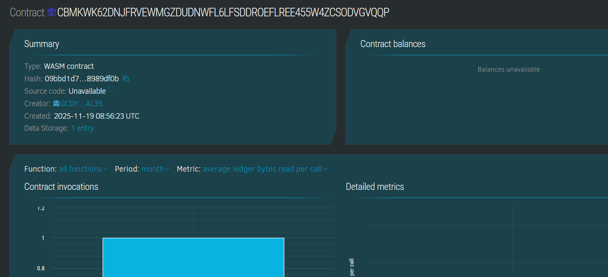

# AuctionMint Market

## Project Title
AuctionMint Market

## Project Description
AuctionMint Market is a decentralized auction platform built on Soroban, the smart contract platform of Stellar. It allows users to create auctions for digital collectibles, place competitive bids, and close auctions to declare winners automatically based on the highest bid. This contract ensures transparency and fairness in bidding for digital assets.

## Project Vision
The vision of AuctionMint Market is to empower creators and collectors in the digital collectibles ecosystem by providing a transparent, trustless, and automated auction platform. We aim to leverage blockchain technology to remove intermediaries, reduce fraud, and increase accessibility in the auction process for digital assets such as NFTs and other tokenized collectibles.

## Key Features
- **Auction Creation:** Users can initiate auctions by specifying the digital collectible item they want to auction.
- **Bidding Mechanism:** Participants can place bids higher than the current highest bid, ensuring fair competition.
- **Auction Closure:** Auction owners have exclusive rights to close the auction, finalizing the highest bid and winner.
- **Secure Bid Tracking:** Each auction keeps track of the highest bid and bidder, stored securely on the blockchain.
- **Active Auction Status:** Auctions have an active/inactive status, preventing bids after an auction has been closed.

## How to Use
1. **Create Auction:** Call `create_auction` with the digital collectible's identifier to start a new auction.
2. **Place Bid:** Any user can call `place_bid` with their bid amount, which must be higher than the current highest bid.
3. **Close Auction:** The auction owner calls `close_auction` to finalize the auction and declare the highest bidder as the winner.

## Future Scope
- **NFT Integration:** Add functionality to mint NFTs for the auctioned collectibles and transfer ownership to the winning bidder.
- **Automatic Payments:** Integrate payment channels for automatic bid settlements and escrow services for security.
- **Timed Auctions:** Support auctions that run for a specified duration with automatic closure.
- **Bid Withdrawal:** Allow bidders to withdraw their bids before auction closure.
- **Frontend Application:** Develop a user-friendly frontend interface and wallet integration for easier access.
- **Multi-Auction Management:** Enable users to manage multiple simultaneous auctions.
- **Auction History:** Store and provide access to past auction records and statistics.

## Technology Stack
- Soroban SDK (Rust) for smart contract development
- Stellar blockchain as the underlying decentralized platform
- Rust language for secure and high-performance contract logic

## Contribution
Contributions to improve AuctionMint Market are welcome. Please fork the repo, create your feature branch, and submit a pull request for review.

## License
This project is open-source and available under the MIT License.

### Contract Details 
ID : CBMKWK62DNJFRVEWMGZDUDNWFL6LFSDDROEFLREE455W4ZCSODVGVQQP

